[](https://nuget.org/packages/BlufiDH) [](https://github.com/emako/BlufiDH/blob/master/LICENSE) [](https://github.com/emako/BlufiDH/actions/workflows/library.nuget.yml)

# BlufiDH

A fast Diffie-Hellman key exchange algorithm in `.NET Standard 1.1` / `2.0` and `.NET 6`–`.NET 10`.

## Example

```c#
const string DH_P = "cf5cf5c38419a724957ff5dd323b9c45c3cdd261eb740f69aa94b8bb1a5c9640" +
    "9153bd76b24222d03274e4725a5406092e9e82e9135c643cae98132b0d95f7d6" +
    "5347c68afc1e677da90e51bbab5f5cf429c291b4ba39c6b2dc5e8c7231e46aa7" +
    "728e87664532cdf547be20c9a3fa8342be6e34371a27c06f7dc0edddd2f86373";
const string DH_G = "2";
const int radix = 16;
const int dhLength = 1024;
BigInteger dhG = BigInteger.Parse(DH_G);
BigInteger dhP = RadixBigInteger.Parse(DH_P, radix);

BlufiDH appDH = new(dhG, dhP, dhLength);
BlufiDH espDH = new(dhG, dhP, dhLength);

BigInteger A = appDH.GetPublicKey();
BigInteger B = espDH.GetPublicKey();

BigInteger keyA = appDH.GenerateSecretKey(B);
Console.WriteLine($"APP computed key: {keyA}");

BigInteger keyB = espDH.GenerateSecretKey(A);
Console.WriteLine($"ESP computed key: {keyB}");

if (keyA == keyB)
{
    Console.WriteLine("Key exchange successful! Both parties have the same shared key.");
}
else
{
    Console.WriteLine("Key exchange failed! The keys do not match.");
}
```

## DH Negotiate Security

```mermaid
sequenceDiagram
    title DH Negotiate Security
    participant APP
    participant ESP

    activate APP
    rect rgb(28, 70, 50)
        APP->>APP: Generate g, p
        APP->>APP: Private key: a
        APP->>APP: Public key: A = g^a mod p
    end
    rect rgb(30, 55, 95)
        APP->>ESP: Send: A, g, p
    end

    activate ESP
    rect rgb(28, 70, 50)
        ESP->>ESP: Private key: b
        ESP->>ESP: Public key: B = g^b mod p
    end
    rect rgb(30, 55, 95)
        ESP->>APP: Send: B
    end
    rect rgb(90, 40, 50)
        ESP->>ESP: Shared key: K = A^b mod p
        APP->>APP: Shared key: K = B^a mod p
    end

```


